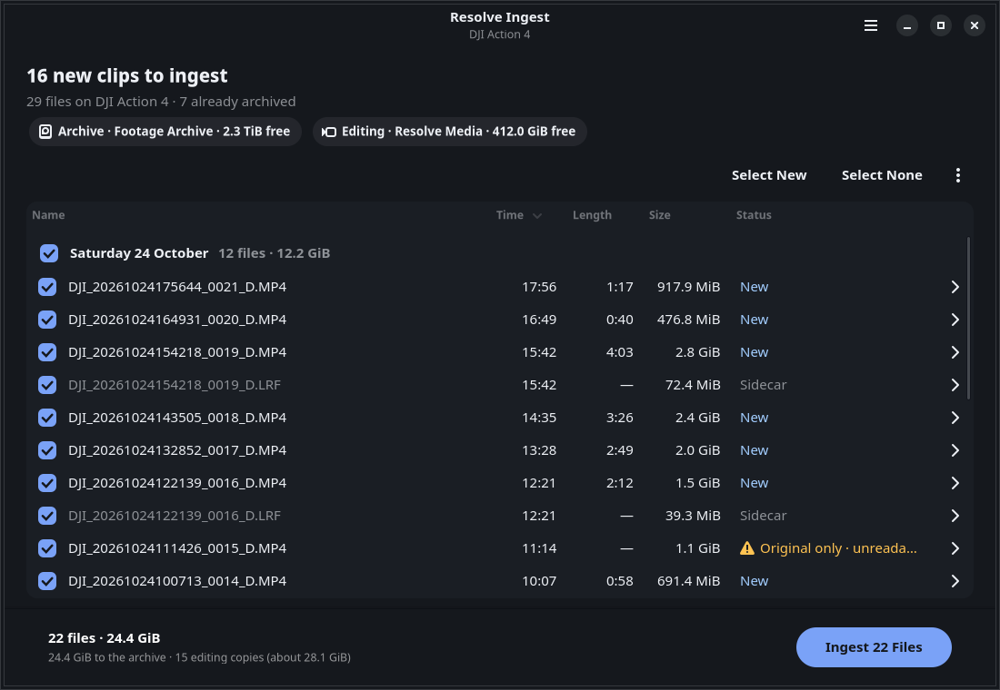
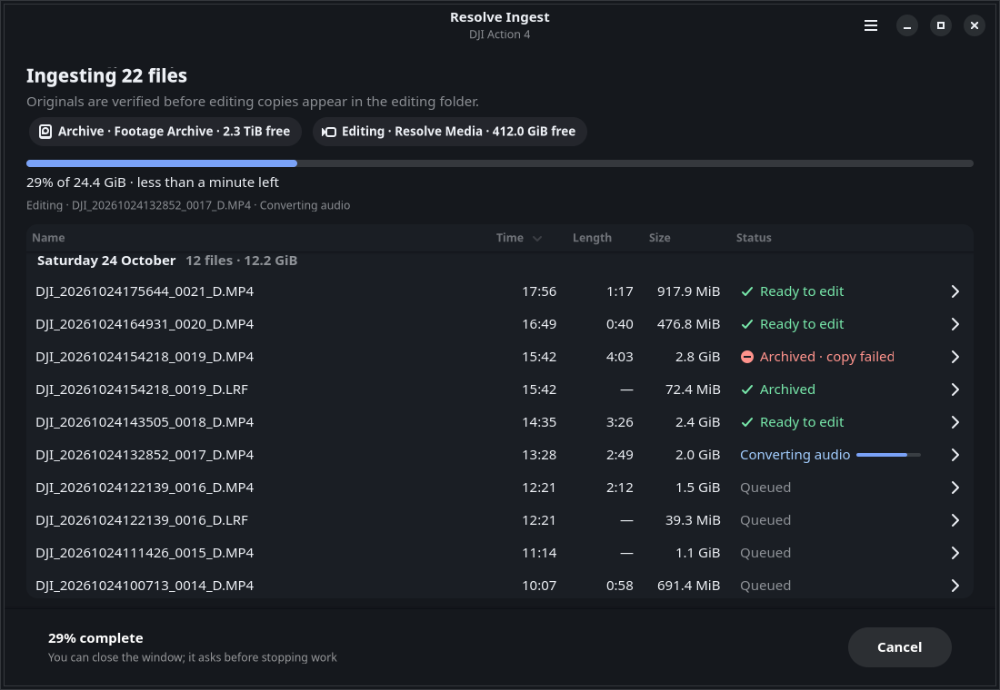
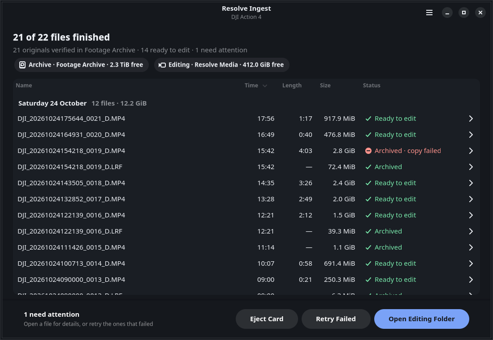

# Resolve Ingest

Insert a camera card, click **Ingest**, walk away. Resolve Ingest copies the originals to your archive and checks every byte. It then creates editing copies for DaVinci Resolve with the camera's video untouched and 24-bit PCM audio. Clips you have already archived are left unselected, so the same card can go back in any time.



It is a Linux desktop app (GTK4/libadwaita) with a headless CLI and a local SQLite journal that makes every batch recoverable. Real-world validation is still open for some camera modes, your Resolve installation, and network-share disconnects; see [validation status](docs/validation/status.md).

## How it works

1. **First run:** choose an **archive** folder (local disk, external drive, or a CIFS/NFS share mounted by the system) and an **editing copies** folder.
2. **Insert a card.** Cards are recognized by their `DCIM` (or Sony `PRIVATE/M4ROOT`) folder and scanned automatically. Clips are grouped by recording day, newest first. Anything already verified in the archive is unselected and hidden, and sidecars (`.LRF`, `.SRT`, …) follow their clip.
3. **Click Ingest.** Destinations, write access, and free space are checked in the background while you choose, so there is no separate preview step. Newest recordings are processed first, and the window shows overall progress, an estimated finish time, and each worker's current step.
4. **Done.** Eject the card, open the editing folder in Resolve, or retry anything that failed. If the window is in the background, a desktop notification tells you when the batch finishes.

| Running | Done |
| --- | --- |
|  |  |

Files are laid out by recording date with the camera's own names:

```
archive/2026-10-24/DJI_20261024175644_0021_D.MP4
archive/2026-10-24/DJI_20261024175644_0021_D.LRF
editing/2026-10-24/DJI_20261024175644_0021_D.mov
```

If a name is already taken (two cards that both start at `GX010001.MP4`, say), the new clip and its sidecars get `-2`, and nothing is ever overwritten. Recording dates come from the filename (including DJI's `YYYYMMDDHHMMSS`), then embedded creation time. A `*` in the Time column marks a file-modification-time fallback.

**Convert existing files** (main menu, or drop a non-card folder on the window) turns footage that is already on disk into `clip.mp4.mov` beside each source, or into the editing folder. Sources stay unchanged and no archive is needed. Resolve's own `CacheClip`, `ProxyMedia`, and backup folders are skipped.

**History** (Ctrl+H) lists every batch with its status. From there you can reopen a batch to retry it, export a JSON verification report, or remove partial files left by an interruption. Verified files are never removed.

### What "verified" means

- **Originals:** SHA-256 while copying from the card, then a full readback from the archive, compared before the file is given its final name. Publishing uses a no-overwrite rename. Readback proves what the client filesystem returns, not a NAS's internal redundancy.
- **Editing copies:** stream layout, formats, colour, rotation, and timing are compared with the source, and a SHA-256 of the copy is recorded. **Preferences → Check editing copies → Thorough** also decodes every frame. That takes longer and is off by default.
- Each destination is remembered together with the drive or share it lives on (by udisks mount point or filesystem UUID for removable drives). An unplugged drive or unmounted share is reported as unavailable; it is never written to as if it were an empty local folder.

See [storage and recovery](docs/storage.md) for the details.

## Install

### Flatpak on Bazzite (or any Fedora Atomic desktop)

Build from the Fedora Distrobox; nothing is layered onto the host image, and FFmpeg ships inside the bundle.

```sh
sudo dnf install flatpak-builder
distrobox-host-exec flatpak remote-add --if-not-exists --user flathub \
  https://dl.flathub.org/repo/flathub.flatpakrepo
./install-flatpak.sh            # build and install/update for the current user
./uninstall-flatpak.sh          # remove the app (add --delete-data to remove its data too)
```

Run it from the launcher as **Resolve Ingest**, or with `distrobox-host-exec flatpak run io.github.resolve_ingest.ResolveIngest`. The sandbox can reach your home folder, `/run/media` (cards and external drives), and `/mnt` (network shares). For a share mounted somewhere else, grant just that path:

```sh
distrobox-host-exec flatpak override --user --filesystem=/var/mnt/footage:rw \
  io.github.resolve_ingest.ResolveIngest
```

Mount network shares through the system (fstab or system settings), not as `smb://` locations in the file manager. Those GVfs paths are refused. Flatpak settings and the journal live under `~/.var/app/io.github.resolve_ingest.ResolveIngest/`. If `Cargo.lock` changes, run `python3 packaging/flatpak/generate-cargo-sources.py` before building.

### From source

Requires Linux, Rust 1.88+, GTK 4.12+, libadwaita 1.5+, and FFmpeg/ffprobe with the MOV muxer and `pcm_s24le` encoder (plus decoders for your camera, e.g. HEVC; Fedora's `ffmpeg-free` lacks HEVC). Bundled tools in `libexec/resolve-ingest` take precedence, then `RESOLVE_INGEST_FFMPEG_DIR`, then `PATH`.

```sh
sudo dnf install gcc pkgconf-pkg-config gtk4-devel libadwaita-devel ffmpeg-free   # Fedora
sudo apt install build-essential pkg-config libgtk-4-dev libadwaita-1-dev ffmpeg    # Ubuntu

cargo run --release                  # the app
cargo run --release -- ~/Videos/raw  # open a card or folder directly
cargo run -- demo                    # the real window on synthetic footage; writes nothing
cargo run -- doctor                  # check FFmpeg support
make install                         # into ~/.local (PREFIX=… to change; FFMPEG_DIR=… to bundle tools)
```

Settings live in `$XDG_CONFIG_HOME/resolve-ingest/settings.toml`; the journal and application lock in `$XDG_DATA_HOME/resolve-ingest`, which must be local storage.

## Headless use

```sh
cargo build --release --no-default-features
resolve-ingest plan   /run/media/me/CARD /mnt/nas/archive ~/Videos/editing   # preflight only
resolve-ingest ingest /run/media/me/CARD /mnt/nas/archive ~/Videos/editing
resolve-ingest history
resolve-ingest retry BATCH_ID [--item N]
resolve-ingest report BATCH_ID report.json
resolve-ingest cleanup BATCH_ID [--remove]
```

`ingest` skips files already verified in that archive (`--include-archived` copies them again). `--archive-only` preserves everything without editing copies, and `--verify full` enables the frame-by-frame decode. Ctrl+C cancels safely. An incomplete batch exits nonzero.

## Development

```sh
make check   # cargo fmt --check, clippy -D warnings, and the full test suite
```

The UI's state machine (`src/ui/state.rs`) has no GTK dependency and is unit-tested. GTK code in `src/ui/` only draws the model and carries out its effects. Engine tests generate short MPEG-4/AAC clips with FFmpeg. They compare archived bytes, decoded frame hashes, and PCM audio, and exercise recovery, corruption, cancellation, symlink/mount escapes, and parent-death supervision. A real DJI Action 4 sample passed ingest with all 6,806 decoded frames matching ([evidence](docs/validation/status.md)).

Background: [original plan](docs/project-plan.md) · [toolkit decision](docs/design/toolkit-decision.md) · [storage and recovery](docs/storage.md)
