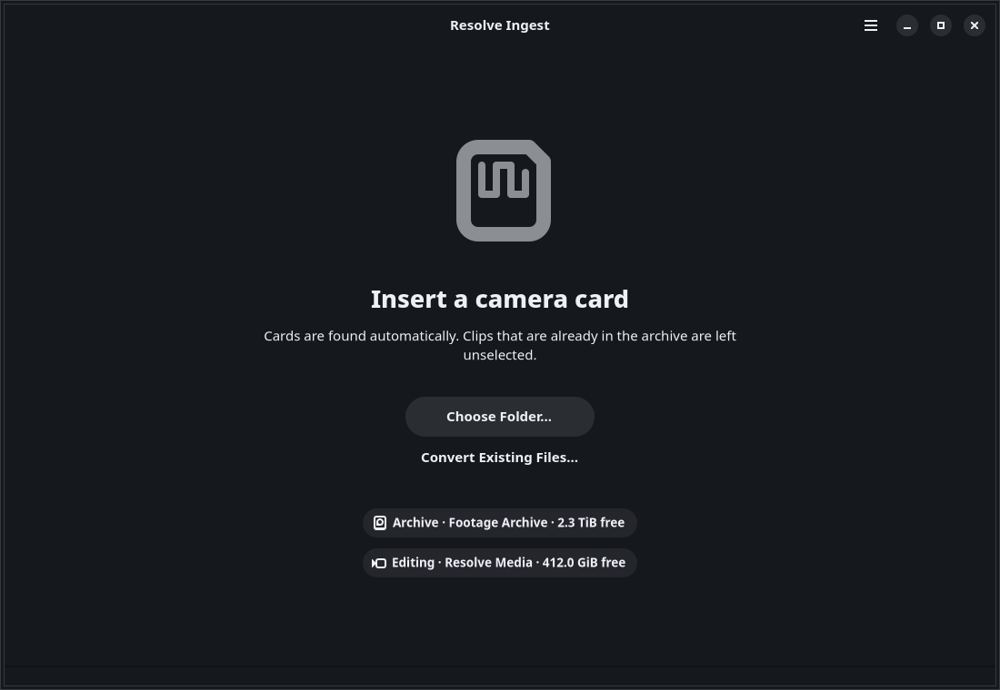
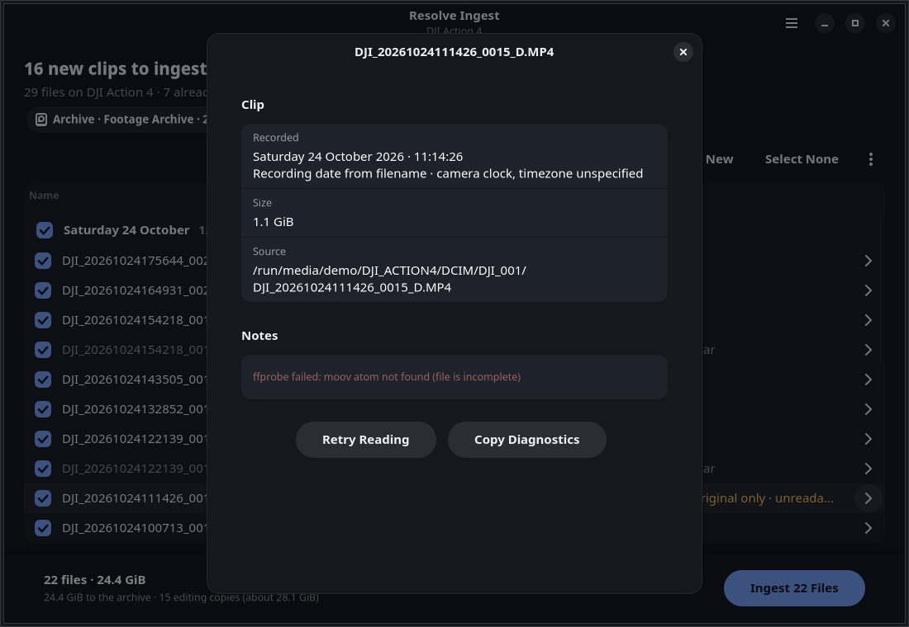
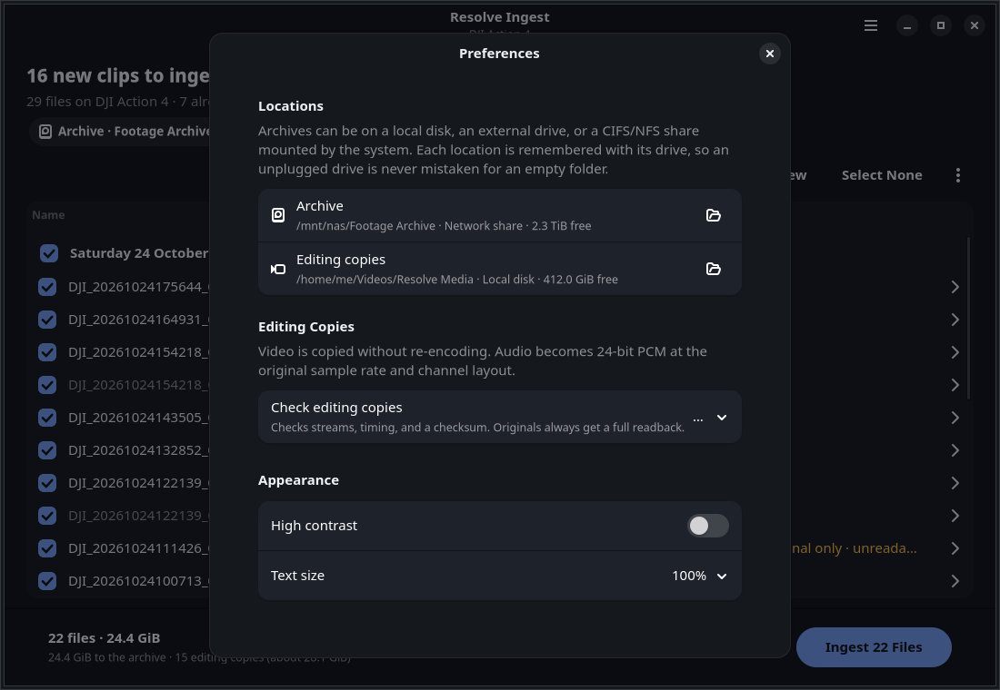
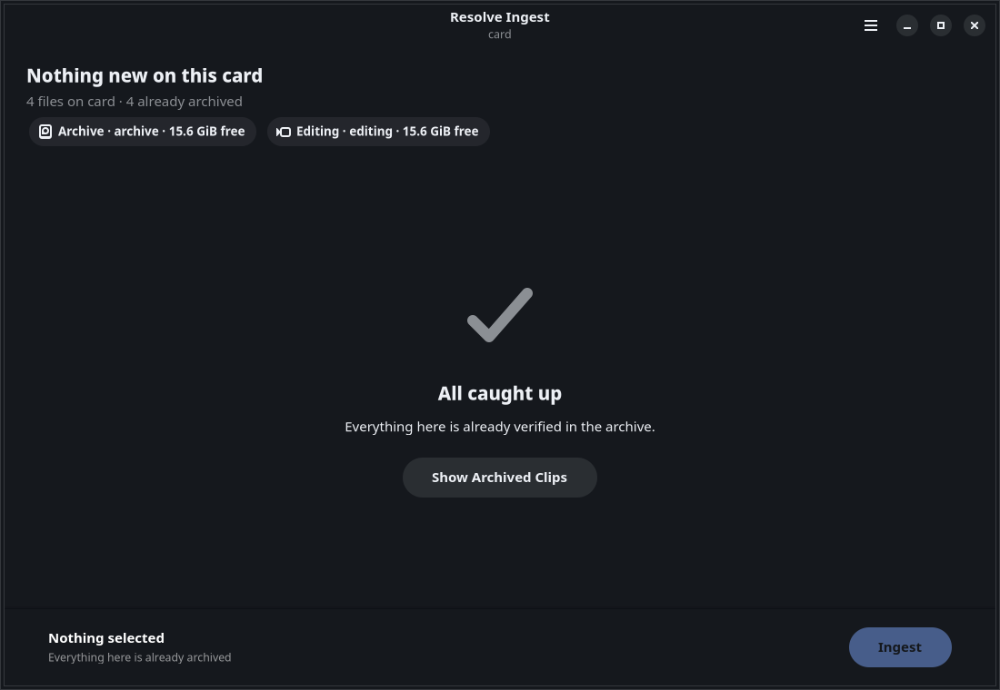
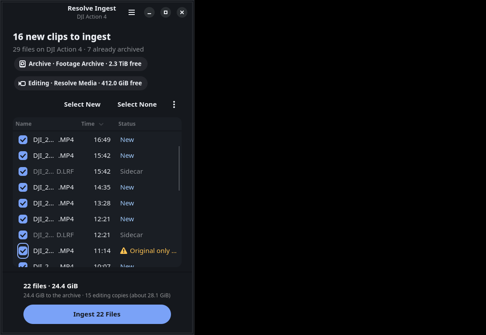

# Desktop toolkit and interface design

## Toolkit

GTK4 (gtk4-rs 0.10) and libadwaita (0.8), targeting GTK 4.12 and libadwaita 1.5 so source builds work on current LTS distributions. The Flatpak uses the GNOME 50 runtime.

The plan named Iced provisionally. The [Iced 0.14 manifest](https://github.com/iced-rs/iced/blob/0.14/Cargo.toml) does not expose an accessibility backend, so it was not a suitable default for this implementation's screen-reader gate. [GTK's accessibility documentation](https://docs.gtk.org/gtk4/section-accessibility.html) describes native accessible roles and properties on its standard controls. That supports choosing GTK; it does not substitute for testing this application's accessibility.

## Architecture

- `ui/state.rs`: the whole interface as data. `Model::update(Msg) -> Vec<Effect>` decides screens, selection, preflight generations, progress, and estimates, with no GTK types, so every screen's behaviour is unit-tested.
- `ui/mod.rs`: builds the window, renders the model, and performs effects (worker commands, toasts, notifications, dialogs).
- `ui/worker.rs`: one background thread owns the job journal and runs engine commands in order. Each command gets its own cancel token, and queued preflights collapse to the newest. The window drains replies and pipeline events every 100 ms, which coalesces progress bursts.
- `ui/clips.rs`: a virtualized `ColumnView` with recording-day sections. Rows carry fixed scan metadata. Progress updates rebind the visible cells of one row in place; they never rebuild the list or move its scroll position.
- `ui/cards.rs`: card detection and eject through `GVolumeMonitor`.
- `ui/demo.rs`: a synthetic worker for `resolve-ingest demo`, so the real window can be explored and screenshotted without media.

## Screens

| Screen | Purpose |
| --- | --- |
| Setup | First run only: choose the archive and editing folders. Advances once both are set. |
| Waiting | "Insert a camera card", with Choose Folder… and Convert Existing Files…, plus where files will go. |
| Scanning | Card name, file count, current file, Cancel. |
| Review | New clips by day, already-archived ones hidden, location chips, one primary button ("Ingest 16 Files"). Preflight runs in the background; a failure shows its reason and offers Check Again. |
| Running | Overall progress, estimated finish, one line per active worker, row-level progress, Cancel. |
| Done | Outcome summary, Eject Card, Retry Failed, Open Editing Folder; a notification if the window is in the background. |

Secondary things live behind the main menu: History, Preferences, Convert Files…, Choose Folder…, Rescan. Each clip opens a details sheet (double-click, Enter, or its chevron) with metadata, destinations, checksums, notes, and per-file actions. Dialogs are `AdwDialog`/`AdwAlertDialog`, which become bottom sheets on narrow windows. Below 700 sp the table keeps name, time, and a shorter status, and the bottom-bar actions stack.

Keyboard shortcuts: Ctrl+Return starts, Ctrl+O chooses a folder, Ctrl+R or F5 rescans, Ctrl+H opens History, Ctrl+, opens Preferences, Ctrl+W/Ctrl+Q closes (asking first while work is running).

## Visual system

The charcoal palette from the plan is kept as libadwaita colour overrides in `src/ui/style.css`; otherwise the app uses libadwaita's own style classes (`boxed-list`, `pill`, `suggested-action`, `title-2`, `dim-label`, `numeric`). Statuses pair words with icons and colour. Calculated sRGB contrast ratios for the current tokens:

| Pair | Ratio |
| --- | --- |
| Text on window `#EDF0F5`/`#15181D` | 15.58:1 |
| Text on table `#EDF0F5`/`#1A1E24` | 14.65:1 |
| Dimmed text (55%) on table | 5.35:1 |
| Accent text `#8FB2FF` on table | 7.95:1 |
| Success / warning / error text on table | 10.76 / 10.76 / 9.22:1 |
| Suggested button label on accent | 7.07:1 |

These token checks exceed the plan's 4.5:1 text threshold; they are not an audit of every native control state. High contrast and 150%/200% text are in Preferences.

## Known GTK behaviour worked around

- After rows are replaced, `ColumnView` re-anchors on the first *row*, which leaves its day header scrolled away. The list pins itself to the top through the first layout after a rebuild.
- Re-showing a hidden column (for the narrow layout) adds that column's cells to section-header widgets as well. Header widgets are recreated after each breakpoint change.

## Open acceptance

The toolkit choice remains subject to an observed Orca walkthrough, native Wayland/portal folder-dialog testing, 100/150/200% display scaling, and a user walkthrough on the supported desktop. The screenshots come from an isolated Xvfb session with a software renderer; see [validation status](../validation/status.md).
